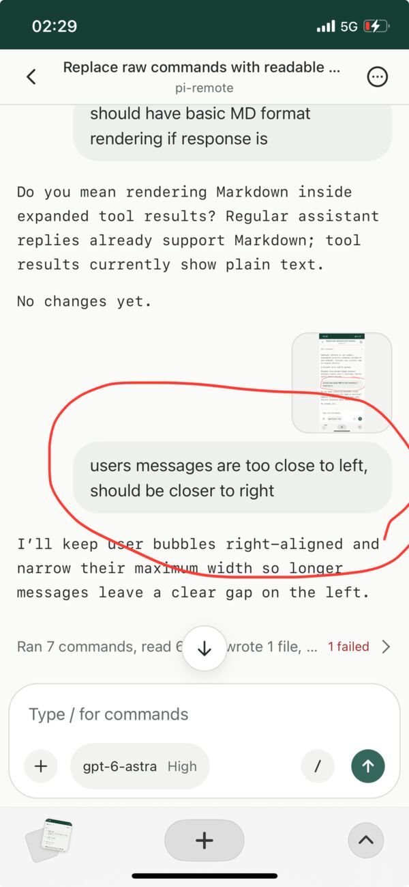
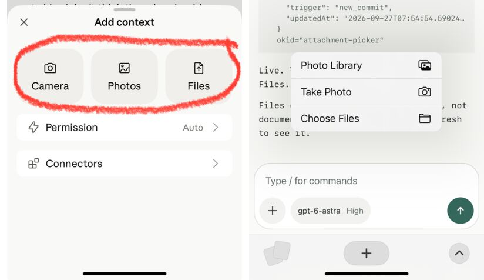
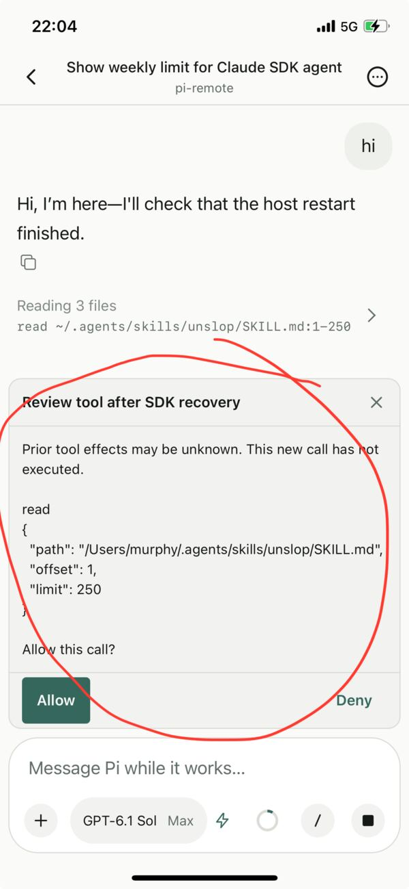

# A red circle is a good enough spec

<!-- description: Most of what I typed while building Pi Remote was a complaint. That turned out to be the whole method. -->

Most of what I typed while building Pi Remote was a complaint. "The send button is too big." "This copy button is a bit blur." "Ugly and it flash."

That turned out to be the whole method.

Pi Remote lets me use the Pi agents on my Mac from my phone. Scan a QR code, see every session, open one, keep talking. The agent keeps working on the computer while I'm on the couch, on a tram, or in bed pretending to sleep.

About two weeks in, I started building Pi Remote from inside Pi Remote. That's when it got fast.

Here's how it goes. It's late. I'm using the app for real work on some other project. Something feels off. A number sits a little too high. A spinner never stops. I take a screenshot, scribble a red circle on it with my thumb, open the pi-remote session and send it. One line of text, usually with a typo.

The agent looks at the screenshot, finds the code, fixes it and pushes. I pull down to refresh. The thing I circled is gone.

*The bug report is a screenshot of the screen it was sent from.*

I don't write a spec. I don't open a ticket. I don't open my laptop. I barely explain anything.

The circle says where. The sentence says what's wrong. The agent can read the code and it can see my screen. That's enough.

It's a bit like getting a suit altered. You don't describe to the tailor how a jacket should fit. You put it on and stand there, and they pin wherever it bunches. You come back next week and it fits a little better. Then they pin it again.

A red circle is a pin. Over six weeks I sent 121 phone screenshots. Most of them had one.

I don't design from scratch, so I point at apps that already got it right. When the composer felt wrong, I sent four screenshots of the Codex app and said do it like this. When the attachment menu felt wrong, I sent the Claude app's. The first attempt came back as a stock iOS menu. My reply was "not right, the UI is also break the pattern." The next try matched.

*What I asked for, and what I got first.*

Waiting is the other thing I complain about. Every time I sat watching the agent wait for something, I made a rule.

Running the full test suite for a one-line fix? Now it runs only the checks for that change, and CI runs the rest. Waiting for CI to go green before telling me it's done? Not anymore. Testing on two Node versions? "Waste of time." Gone the same night.

Each rule saves a minute or two. I run this loop dozens of times a day, so it adds up. None of the rules are clever. They're written down in a file the agent reads, so I never have to say them twice.

Deleting got easy too. I asked for swipe gestures to pin, hide and delete sessions. They hid the search button. I asked for a revert. The feature lived on main for 24 minutes.

After one recovery fix, the agent added a safety prompt that asked me to approve every tool call. Sensible on paper. On a phone at midnight, it was asking me whether reading a file was okay. I asked what it was for, then had it removed.

*Safe, and useless on a phone.*

When putting something back costs one sentence, you stop being precious about anything.

The phone also changes what gets built. I wouldn't have thought of most of it at a desk. A small haptic tap when you copy a reply. Pulling down to close an image. A composer that stays small while the keyboard is up, because your thumb and the keyboard already cover half the screen. A working label that says "Mulling it over" instead of a bare spinner, and "Chipped away for 10m 52s" when it's done. You only notice these things when you're holding the app in one hand.

Sometimes I don't even type. I dictate. One night my phone turned a perfectly reasonable request into "dissect light cloud cloud as stick agent model should walk the same as other motors." I asked the agent to say it back in its own words. It did. I wanted the Claude SDK model to work like every other model, and tests to prove it. That's exactly what I meant.

That Claude request was the one time the loop got long. A question on October 13, "can Pi use Claude's Agent SDK?", turned into a week of research, experiments and late-night fixes, all steered from the phone. It ended up as its own public repo, pi-claude-sdk. Some complaints are bigger than a button.

I did count. 419 commits in 45 days. 59 on the busiest day. 161 of them between 11pm and 3am.

Those numbers don't tell you whether Pi Remote is any good. They tell you how short the loop is. To find out if it's good, I do the same thing every time. I open it on my phone and look for something to circle.

There's always something.

-BySepStudio
