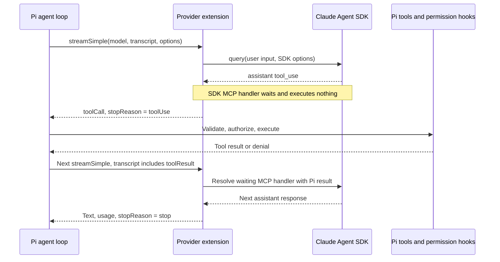

# Integrating the Claude Agent SDK as a Pi model

This is an implementation blueprint, not an installed provider. It targets the original goal: selecting Claude SDK access in Pi's `/model` while keeping Pi's tools and extensions. It differs from Amp's separate-agent mode.

Checked against `@anthropic-ai/claude-agent-sdk` 0.3.296, its shipped `sdk.d.ts`, and installed Pi 1.1.0. See [research and live evidence](claude-agent-sdk.md) for policy, experiments, and limitations.

## Ownership



The provider must not execute the tool in its MCP handler and then also emit a Pi tool call. Pi remains the only executor. The SDK still owns its internal model loop and transcript; the adapter coordinates the two, it does not remove the SDK loop.

## SDK interfaces to use

| SDK interface | Integration responsibility |
| --- | --- |
| `query({ prompt, options })` | Start the SDK conversation and consume typed events |
| `prompt: AsyncIterable<SDKUserMessage>` | Keep an interactive process open for successive user inputs; supports images and control methods |
| `createSdkMcpServer()` and `tool()` | Advertise Pi-backed tools to Claude through an in-process MCP server |
| `tools: []` | Remove SDK built-in tools so they cannot bypass Pi execution |
| `strictMcpConfig: true` | Limit MCP discovery to explicitly supplied servers |
| `settingSources: []` | Avoid implicitly loading user/project Claude settings alongside Pi's instructions |
| `includePartialMessages: true` | Receive `stream_event` deltas, not only complete assistant messages |
| `canUseTool` | Allow only the declared bridge tools into the SDK handler; Pi still decides whether the underlying action may execute |
| `supportedModels()` / `accountInfo()` | Obtain SDK model/account metadata after initialization; do not log account identities or credentials |
| `resume`, `forkSession`, `resumeSessionAt` | SDK history controls, not automatic equivalents of Pi's session tree |
| `interrupt()` | Interrupt streaming-input execution; queued inputs may remain, so it is not a sufficient hard-stop operation by itself |
| `close()` and `abortController` | Terminate the SDK query and cooperate with cancellation in host work |

`tool()` accepts a Zod raw shape; Pi declares tools with TypeBox/JSON Schema. A general adapter needs a checked schema conversion or an MCP server that preserves the original JSON Schema. Do not replace validation with an unrestricted `any` schema. The existing experiment uses one explicit schema and does not solve arbitrary conversion.

## Smallest SDK-facing example

This is a single-tool code sketch. `userPrompt`, `cwd`, and `piSystemPrompt` are supplied by the host. The event-to-Pi conversion is the next section, not hidden inside this snippet.

```ts
import { query, createSdkMcpServer, tool } from '@anthropic-ai/claude-agent-sdk';
import { z } from 'zod';
import type { CallToolResult } from '@modelcontextprotocol/sdk/types.js';

// One outstanding synthetic tool result, as in the tested experiment.
const pending = Promise.withResolvers<CallToolResult>();
const abortController = new AbortController();
const server = createSdkMcpServer({
  name: 'pi',
  alwaysLoad: true,
  tools: [tool(
    'probe', 'Return a synthetic test token', { label: z.string() },
    async () => pending.promise,
  )],
});

const run = query({
  prompt: userPrompt,
  options: {
    cwd,
    model: 'haiku',
    systemPrompt: piSystemPrompt,
    tools: [],
    mcpServers: { pi: server },
    strictMcpConfig: true,
    settingSources: [],
    includePartialMessages: true,
    persistSession: false, // Scratch demo only, not restart support.
    abortController,
    canUseTool: async name => name === 'mcp__pi__probe'
      ? { behavior: 'allow' }
      : { behavior: 'deny', message: 'Tool is not exposed by Pi' },
  },
});

// Called after Pi executes/denies the tool and its call ID is matched:
function returnPiToolResult(result: CallToolResult) {
  pending.resolve(result);
}

// Called on abort/shutdown; the caller must also reject new input:
function stop() {
  pending.resolve({ content: [{ type: 'text', text: 'Aborted' }], isError: true });
  run.close();
  abortController.abort();
}
```

The two callbacks run later through the adapter's lifecycle handling. For runnable code rather than a sketch, use the [assert-based Pi handoff experiment](https://github.com/peterlimg/pi-remote/blob/328a4fe/experiments/claude-agent-sdk/pi-handoff.mjs).

## Pi-facing provider logic

```text
streamSimple(model, transcript, options)
  if options.signal is aborted
    return an aborted Pi stream without touching the SDK

  if this is the next user input in the known live conversation
    start or feed this session's SDK query
  else if this supplies results for outstanding SDK tool calls
    validate call IDs and resolve the waiting MCP handlers
  else
    reject unsupported history changes rather than silently lose context

  consume SDK events
    stream_event     -> Pi text/thinking/tool argument deltas
    assistant        -> finalize blocks and preserve tool call IDs
    complete tool-call batch -> finish this Pi response with toolUse
    user/tool_result -> acknowledge SDK echo; do not execute or record twice
    result           -> finalize the Pi response and SDK usage accounting

  on abort
    stop accepting input; release waiting handlers; close SDK query
    suppress late content; emit one aborted terminal Pi event
```

Real implementation must handle a complete assistant tool-call batch, not just stop on its first tool block. Multiple same-name calls with identical arguments require reliable correlation to their SDK and Pi call IDs. The shipped MCP handler's `extra` argument is typed `unknown`; do not assume it contains a documented Anthropic tool-use ID. The single-call experiment avoids that unresolved mapping problem.

A streaming-input query can span user turns. A `result` then ends the current run, not necessarily the lifetime of the input generator. The earlier experiment used string input and one live query; persistent streaming input is documented but not verified by that experiment.

## Extension and authentication boundary

Keep this in a separate Pi extension package, not in Pi Remote's browser bundle:

```text
pi-claude-sdk/
  index.ts       registerProvider + model metadata + session lifecycle
  bridge.ts      SDK query, pending tools, event conversion, cancellation
  bridge.test.ts tool round trip, denial, batching, abort, history mismatch
```

Use `pi.registerProvider()` with a native provider and custom `streamSimple`. Source Pi prompt/tool state from `getCurrentSystemPrompt(context.messages)` and `getCurrentTools(context.messages)`. Own query state per Pi session, not in one process-global singleton. Release it on session replacement, model changes, extension reload, and shutdown.

For local subscription access, sign in using Claude's supported local login and let the SDK resolve it. No token copying into `models.json`, no fabricated API key to bypass model availability, and no browser credential delivery. The provider must explicitly model ambient SDK authentication and report unavailable/expired login instead of advertising unconditional availability. Startup/CLI inspection should not launch a long-lived agent just because the extension factory loaded.

Pi Remote already discovers registered models via `ctx.modelRegistry.getAvailable()` in `extension/index.ts` and `get_available_models` in `src/rpc.mjs`. A correctly registered provider should appear without a picker redesign, but terminal and RPC authentication/discovery still need tests.

## First implementation scope

Start with fresh SDK-backed Pi sessions, text input, one explicitly exposed tool at a time, normal Pi permission hooks, streaming, accurate usage, and hard cancellation. Fail clearly on unsupported resume, compaction, branch changes, or cross-provider history rather than flattening old messages into a new user prompt. Keep SDK context-management changes detectable so the two histories cannot silently diverge.

Before calling this a normal `/model` provider, verify parallel-call correlation, SDK-to-Pi checkpoint mapping, process restart, cross-provider handoff, images, reasoning settings, malformed streams, and actual serialized errors. Provider request/response instrumentation also needs an honest mapping: the SDK does not expose every underlying HTTP detail available to Pi's direct HTTP providers. Do not fabricate response headers.

Previously verified: local login without an API key, SDK streaming and native resume, and one real Pi tool call/denial/abort. Not verified here: a registered provider extension or the broader behavior above.

## Primary references

- [SDK TypeScript reference](https://code.claude.com/docs/en/agent-sdk/typescript)
- [Custom tools](https://code.claude.com/docs/en/agent-sdk/custom-tools)
- [Streaming input](https://code.claude.com/docs/en/agent-sdk/streaming-vs-single-mode)
- [Sessions](https://code.claude.com/docs/en/agent-sdk/sessions)
- [Pi provider documentation](https://github.com/earendil-works/pi/blob/main/packages/coding-agent/docs/custom-provider.md)
