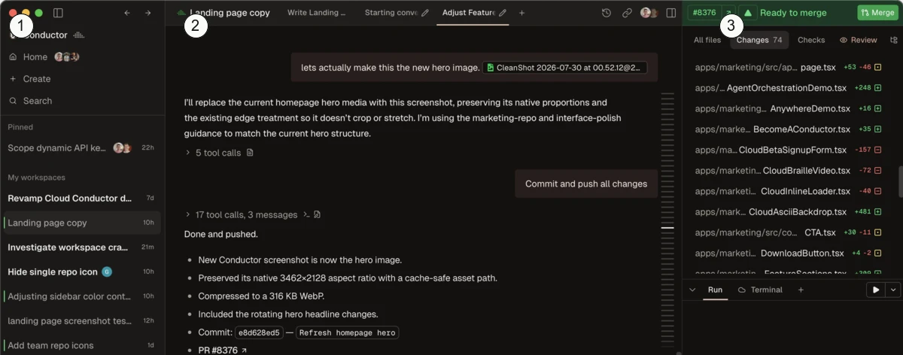
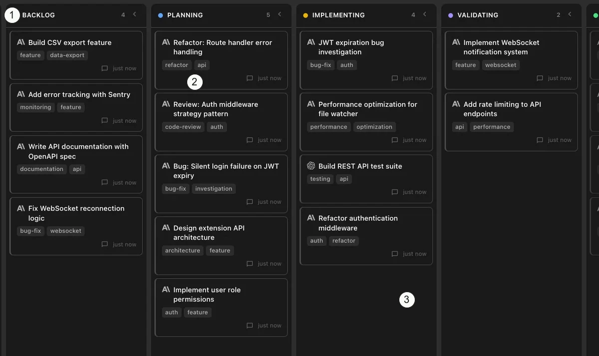
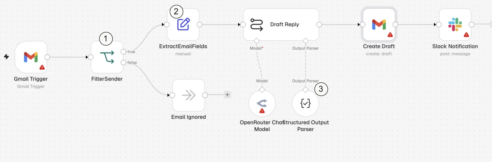
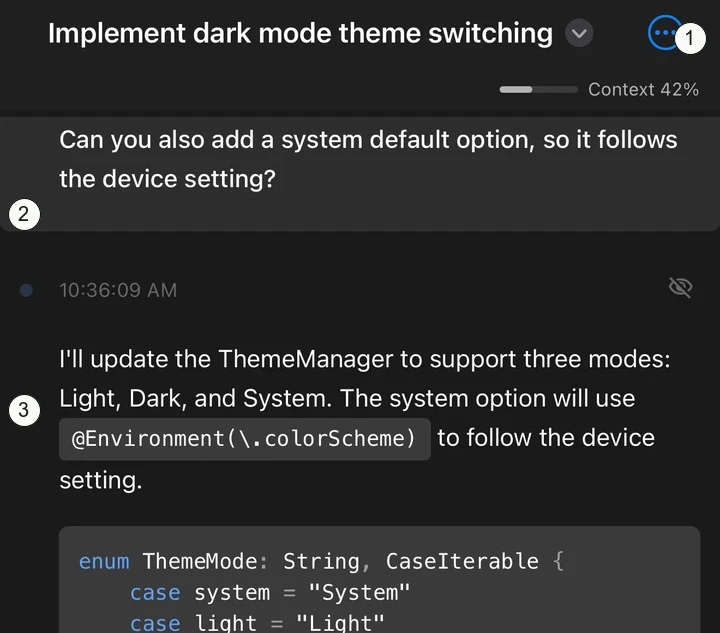
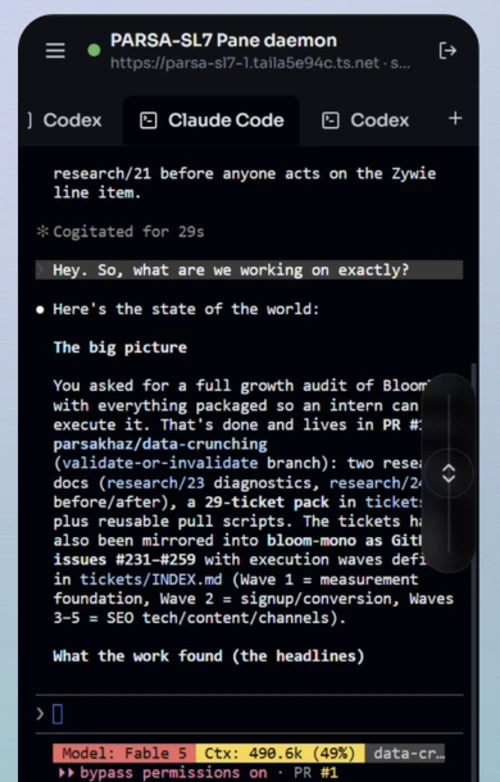
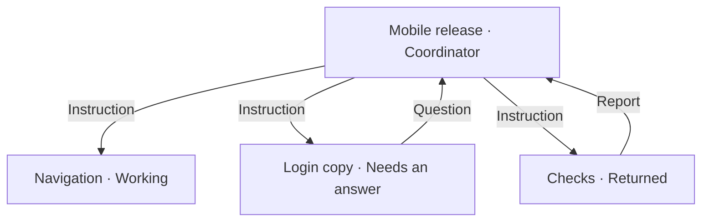

# Coordinator design: visual references and directions

I recommend a **coordinator-owned workspace** as the next visual study. Workers need recognizable places, and questions and returned work need destinations outside the transcript. Another treatment of the nested worker list will not get us there.

This board uses actual published product images. Numbers are our annotations. The saved images are cropped and resized; original assets and their first-party pages are linked below each reference. These are visual observations, not live-app usability findings. The proposed Pi Remote layouts are separate from that evidence.

## Reference board

### A. Conductor separates navigation, conversation, and results



1. Muted navigation, a filled selection, and an edge marker establish the current workspace.
2. The conversation has a broad reading area. Messages do not each need their own panel.
3. Changes have a separate region with its own header, status, and index. A result is more than a completion sentence.

Borrow the boundaries and unequal emphasis. Do not squeeze these three desktop columns onto a phone or copy its composer. The people pictured are collaborators, not evidence of worker ownership.

[First-party page](https://www.conductor.build/) · [Original desktop screenshot](https://www.conductor.build/conductor-app-hero-dark.webp)

### B. Nimbalyst makes simultaneous sessions occupy space



1. Phase headings stay in recognizable locations. Text, counts, and colored markers work together.
2. Each session is a bounded object. The task title leads; tags and timestamps retreat.
3. Full-height lanes and gutters group sessions even where there is empty space. The layout communicates more than a succession of rows.

Borrow spatial grouping and title hierarchy. Do not copy five phone-width-overflowing columns, mandatory dragging, or tags everywhere. Planning and Implementing are development phases, not proof that an agent is running or blocked. There are no coordinator return paths in this image.

[First-party README](https://github.com/Nimbalyst/nimbalyst) · [Original desktop screenshot](https://raw.githubusercontent.com/Nimbalyst/nimbalyst/main/.github/assets/sessions-kanban-dark.webp)

### C. n8n makes relationships visible with directed paths



1. A named junction has visibly different outgoing branches.
2. Arrowheads and connected steps show direction without requiring a prose explanation.
3. Dashed model/parser connections look different from the main workflow path. Different relationships need different line meanings.

Borrow named endpoints and explicit direction. This is a workflow editor screenshot, not evidence of live worker traffic or mobile supervision. Do not copy connection handles, an infinite canvas, or configuration warnings as execution status. A task dependency also must not look identical to coordinator ownership.

[First-party README](https://github.com/n8n-io/n8n) · [Original desktop screenshot](https://raw.githubusercontent.com/n8n-io/n8n/master/assets/n8n-screenshot-readme.png)

### D. Nimbalyst's phone view gives identity and content different layers



1. The task title has its own header. The meter explicitly says Context 42%; it is not completion progress.
2. The instruction occupies a lighter, full-width area.
3. The response has readable body text and a distinct background. Code is another inset object.

Borrow this separation of roles, not its input controls. The original code exceeds the readable width. No parent coordinator or sibling overview is visible, so this is evidence for phone hierarchy only.

[First-party mobile page](https://nimbalyst.com/mobile-agent-management/) · [Original published iPhone screenshot](https://nimbalyst.com/_astro/iphone-detail.CtURFZy8_1VU03A.webp)

## What the other references add

[Paradev's review screenshot](https://raw.githubusercontent.com/ParadevAI/Paradev/main/apps/marketing/public/images/readme/diff-viewer.png) gives returned work a branch identity, aggregate change counts, a file index, and a large inspection area. Pi should borrow the reviewable object, not side-by-side phone code columns. Its [README](https://github.com/ParadevAI/Paradev) identifies Paradev as formerly Superset; the inspected assets retain Superset branding.

[Vibe Kanban's workspace screenshot](https://raw.githubusercontent.com/BloopAI/vibe-kanban/main/packages/public/vibe-kanban-screenshot-workspace.png) also separates agent conversation from artifact inspection. It does not demonstrate coordinator ownership. Treat it as a visual reference, not a vendor recommendation: the [first-party shutdown notice](https://www.vibekanban.com/blog/shutdown) says bloop is closing and the project continues as community-maintained open source.

[Pane's README](https://github.com/greenfield-inc/Pane) documents a global orchestrator terminal that operates across worktrees. That is relevant behavior, but the inspected image does not show that orchestrator managing workers. Its phone crop is a useful warning about carrying terminal density onto a small screen:



[Original desktop-and-phone marketing composite](https://raw.githubusercontent.com/greenfield-inc/Pane/main/assets/readme-remote-pane.png). Tabs establish a selected agent, but this crop requires reading terminal text to understand the work. We should not reproduce that burden in Pi Remote.

## What the rejected prototype gets wrong visually

These are observations of the saved `e3bc856` captures, not an explanation of the user's motives.

- The desktop repeats workers in the sidebar and the conversation. Both use similar small rows; neither gives active work a substantial area.
- Large empty space follows the assignment rows. It does not communicate concurrency, ownership, or what is changing.
- The phone correction scene places the route in a small metadata line beneath prose. Understanding the relationship still requires reading the transcript.
- Questions and returned artifacts share the conversation's scrolling space. They lack recognizable destinations when returning to the coordinator.
- The storyboard explanation bar competes with the product header. The next visual study should show the product frame without that extra instructional layer.

The problem is composition, not a shortage of labels or controls. Pi's typography, panel colors, hairlines, and icon language can remain familiar while the organization changes.

## Three structurally different directions

These are proposals, not observed behavior in the references. None has user approval.

### 1. Worker workspace, recommended first

The coordinator owns one bounded workspace. Compact worker panels occupy stable positions, each with a task name, a labeled execution state, and a readable activity line. They are work areas, not transcript thumbnails. Questions and returned artifacts have their own receiving area.

```text
┌───────────────────────────────┐
│ Mobile release · Coordinator  │
├───────────────┬───────────────┤
│ Navigation    │ Login copy    │
│ Working       │ Needs reply   │
├───────────────┴───────────────┤
│ Checks · Returned report      │
├───────────────────────────────┤
│ Questions / returned work     │
│ Coordinator conversation      │
└───────────────────────────────┘
[ Existing Pi Remote composer   ]
```

Conductor supports separating jobs into different areas; Nimbalyst supports bounded sessions. Containing those sessions within an owning coordinator is our proposal. Opening a worker makes its transcript the main view, with an explicit return to its coordinator.

This is the strongest starting point because worker identity keeps a place. Its phone risk is serious: panels can consume the conversation area, especially with the keyboard open. Shrinking text or hiding the workers would invalidate the direction.

### 2. State board

Group work into full-width areas for Needs an answer, Working, and Returned. Within each area, session tiles show their owner and task. A question is a replyable object; a returned artifact has a preview. State determines location rather than a worker's permanent position.

Nimbalyst's board supports this spatial approach, but its development phases are not our proposed execution states. The phone version must avoid horizontal column hunting and drag-dependent actions.

This favors finding what needs attention over remembering where a worker lives. The risk is movement: workers change places as their state changes. It also needs explicit coordinator ownership, which an ordinary task board does not supply.

### 3. Dispatch map

Make the coordinator and worker relationships the main picture. Instructions, questions, and returns travel on named, directed connections. Selecting a message opens a full-width reading area. This relationship sketch is not a proposed phone layout:



n8n supports the visual language of directed connections. Applying it to independent Pi sessions is our inference, not a demonstrated interaction. The map would be read-only, with no node editing or tiny connection handles.

This most directly shows delegation and return. It also has the highest phone risk: crossed lines, offscreen workers, and messages too small to read. It should not become the default merely because a diagram looks impressive on desktop.

## Constraints for the next visual study

- Preserve the exact production `#composer` markup from `web/index.html` and use unmodified `web/style.css` for it. Attach, model, effort, usage, slash commands, textarea, and Send/Stop retain their normal session-specific behavior.
- Put session and recipient context outside the composer. Entering a worker opens that worker's session; its Stop must not silently become a global stop.
- Compare the directions with the same content at a 390-pixel phone width: Navigation working, Login copy asking a question, Checks returning a report, and the coordinator's conversation. Include the keyboard-open case.
- Judge ownership, concurrent activity, question destination, returned work, and the return path before adding interaction code. Do not use functional test results as design approval.

The next step should be a visual composition study of the worker workspace, not another functional patch to the existing prototype.

Skipped live product interaction and new prototype work. The unresolved risk is whether the proposed workspace remains readable on a phone with the complete composer and keyboard visible.
