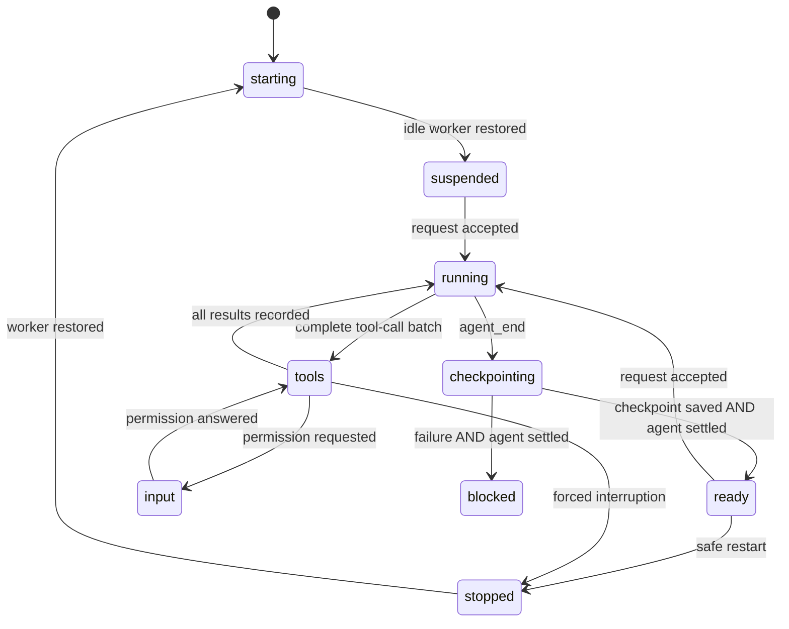

# Managed session lifecycle

The phone's `idle` label is presentation, not permission to restart a worker. Pi can emit `agent_end` before queued work settles or the SDK checkpoint is written.

`src/session-lifecycle.mjs` owns restart readiness for host-managed RPC workers. Its interface is `send(event)` and a read-only `snapshot`. It has no filesystem, process, browser, credential, or SDK dependencies. The worker adapter feeds actual RPC events through it. `SessionService` forwards transitions for diagnostics and E2E assertions.

## Live session seam

`SessionService.live` holds adapters from `src/live-session.mjs`, not transport records. Both provide `state`, `command(command, requestId)`, `answer(answer)`, `close()`, `resumable`, `read(savedHistory)`, and `syncTitle(title)`. Shared `update(changes)` increments the revision and `notify()` sends state/list notifications. The service owns catalog and history reads, admission checks, pins, projects, new/resume/restore orchestration, and the command journal.

`WorkerSession` owns the RPC worker, session lock, dialogs, display-state event updates through the existing `applyEvent` reducer, and lifecycle. Its `managed` snapshot includes outstanding RPC requests in restart readiness. Startup inspection, fresh-session attachment, and history restoration are worker-specific operations used by the service's orchestration.

`BridgeSession` owns the terminal socket, pending acknowledgements, their 30-second deadlines, and disconnect cleanup. It keeps terminal snapshots authoritative while connected and repairs legacy text-only image previews through the service's saved-history reader. Its `managed` snapshot is absent, so terminal sessions never enter the host's worker restore list. The phone and extension protocols are unchanged.



## State contract

| Phase | Meaning | Restart-safe? |
| --- | --- | --- |
| `starting` | Worker handshake or restoration is unfinished. | No |
| `suspended` | A cold worker has no active operation. SDK history is checked separately when it is used. | Yes |
| `running` | A request was accepted or the agent is working. | No |
| `tools` | One or more tool results are outstanding. Permission and execution are both unfinished work. | No |
| `input` | An open dialog overlays the underlying phase. Closing it restores that phase. | No |
| `checkpointing` | The run ended but required receipts are missing. | No |
| `ready` | The agent settled; SDK workers also acknowledged saving their checkpoint. | Yes |
| `blocked` | A failed turn has settled. Recovery still needs investigation; no tool results are invented. | Yes, but not automatically SDK-resumable |
| `stopped` | The worker exited. Unknown tool outcomes remain recorded as blocked recovery. | No live worker remains |

For an SDK turn, `checkpointing.waitFor` starts with `settled` and `checkpoint`. Either receipt may arrive first. Receiving only one cannot make the worker `ready`. Other providers require `settled` but not the SDK-specific checkpoint receipt.

The SDK extension sends a one-shot `claude-sdk-checkpoint` status only **after** `pi.appendEntry()` stores its checkpoint. A missing checkpoint produces an unavailable receipt rather than pretending the turn is recoverable. The status carries no conversation content, credentials, native session ID, or tool arguments.

New input during a running tool does not reset its pending tool IDs. A late startup snapshot cannot roll a running session back to idle. Outstanding RPC requests and startup/restoration work also block a restart.

Automatic restoration starts one worker at a time to bound cold-start load. Shutdown remembers live workers and restorations still queued or in progress. Failed attempts produce warnings and remain manually resumable, but are not carried into every future restart. Session files are never removed.

Restart-safe and SDK-resumable are different capabilities. Stopping an already failed, quiescent worker cannot undo its tools, but it does not resolve an unknown tool result. Native checkpoint, history, configuration, and tool-result validation remain in the SDK provider. There is no automatic tool replay or permissive history fallback.

## Resume on the Mac

When a terminal resumes a phone-owned session, the extension requests `POST /_pi/handoff` over authenticated loopback HTTP. The host releases only its own restart-safe worker, including the outstanding-request check. New phone commands are refused while that worker exits. The terminal then claims the normal exclusive lock and reconnects the phone through its bridge. Other terminal owners cannot be displaced.

A working session, open dialog, pending command or unfinished checkpoint refuses the handoff without stopping the worker. Wait for it to settle, then `/reload` or resume again on the Mac. A failed provider turn still requires its existing recovery checks; handoff does not bypass them.

## Safe restart path

```text
node scripts/restart-and-resume.mjs
  queue a detached job and return immediately
  wait for all managed workers to be restart-safe
  request an idle-only stop
    busy now? refuse without stopping anything
    still safe? stop admission, save the restore list, close workers
  start the replacement host
  restore the same session files
```

The immediate CLI response says **queued**, not restarted. Check `~/.pi/remote/restart.log` and host status separately. Control requests allow ten seconds for a response. A transient `EHOSTTIMEOUT`, including the first preflight request, is retried within the existing five-minute readiness deadline; it is never interpreted as an idle or absent host. Retry and failure logs include the job PID. If sessions do not settle or the host remains unresponsive, the job exits with an explanation and leaves the host running. Do not wait for that job from inside an agent tool: the tool's own turn must finish first.

The authenticated loopback control endpoint reports the host's Node `execPath` alongside `busyWorkers` and `managedSessions` snapshots without prompts or tool arguments. Guarded restarts reuse that executable and put its directory first on the replacement host's `PATH`, so Pi workers do not silently switch Node architectures when the restart caller uses a different runtime. Older hosts without this field use the caller's runtime for their one-time upgrade; select the intended Node explicitly for that upgrade.

The control endpoint `DELETE /_pi/remote` with `X-Pi-Remote-Idle-Only: 1` checks readiness in the host before closing connections. New commands are refused once shutdown starts. Modern hosts alone write their restore list; concurrent restart jobs cannot overwrite it. Safe-mode authentication failures refuse the operation throughout shutdown polling and startup, without forced cleanup.

A running pre-lifecycle host has no atomic idle-stop capability. Its one-time upgrade path checks host-owned sessions through the existing authenticated loopback protocol and waits for completed SDK responses to have a later checkpoint. That compatibility path retains the older host's limitations; subsequent restarts use the lifecycle barrier.

Explicit `stop`, direct process termination, and the low-level force-restart helper remain force operations. They can interrupt tools. If a tool's outcome is unknown afterward, recovery stays blocked rather than running it again.

## Verification

From the repository root, with its existing Playwright dependencies and Chromium installed:

```sh
npm run test:lifecycle
```

This is an E2E test of the real host, WebSocket authentication, mobile Chromium, restart CLI, detached jobs, filesystem persistence, and replacement-host restoration. The Pi/SDK peer is a deterministic RPC replay fixture, so no login, provider credits, or model calls are required. It does not claim live SDK inference or physical Safari coverage.

The replay gates permission, tool completion, checkpoint saving, and final settlement independently. It delays one real HTTP status response beyond the ten-second client timeout and requires both queued restart jobs to survive, remain blocked by permission, and later complete. It also checks both receipt orders, in-flight input, generic-provider settlement, rejected requests, concurrent restart jobs, authentication refusal, two complete host restarts, unchanged history, no completed-tool replay, and fail-closed recovery after a forced interruption. Its artifact includes the observed lifecycle transition trace. CI runs it once in the browser job.

For a historical-controller counterexample, `PI_TEST_RESTART_SCRIPT` can point this E2E at a captured older restart script. The test must detect a host stopping while permission or tool work is outstanding. Live SDK acceptance remains a separate check and must not be inferred from the replay test.

`node test/terminal-handoff-e2e.mjs` uses real Pi processes and a local input/command fixture, without model calls. It checks idle handoff, continued local and phone input, busy-command refusal and retry, exclusive terminal ownership, control authentication and preserved history. It uses the same installed Pi entry as `test/pi-smoke.mjs`, optionally selected with `PI_REMOTE_SMOKE_PI_ENTRY`. CI runs it in the Pi smoke job.
