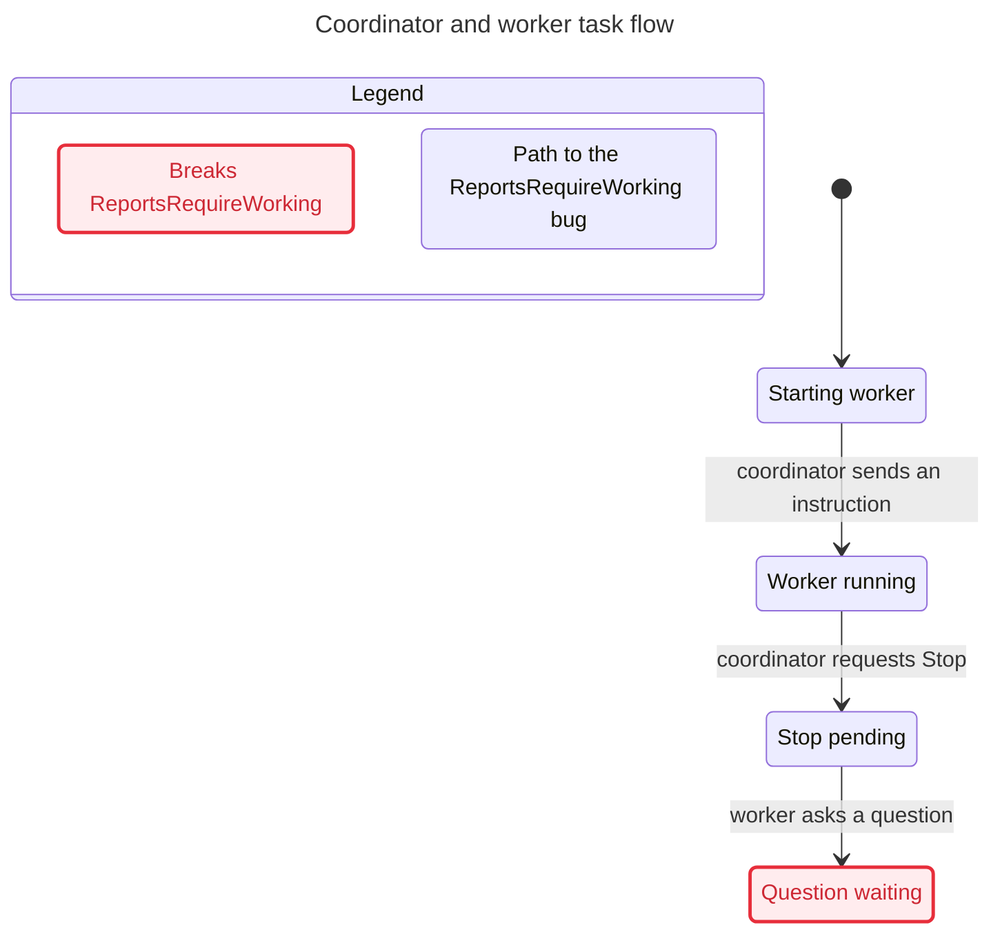
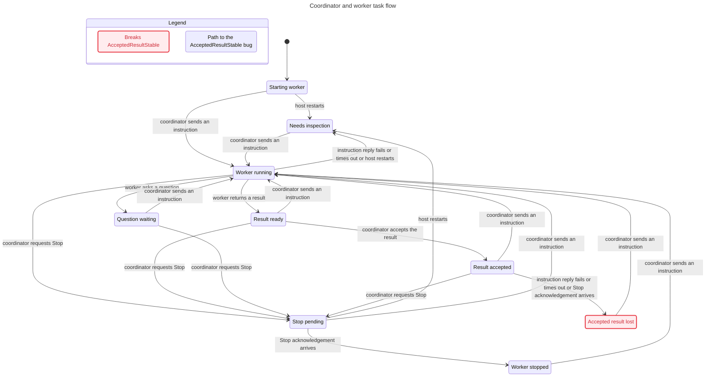

# Coordinator ordering findings

Source confirmed at `5720555fe156c9b538c21373d5a7aad0514212fd`. Product code was not changed by this verification.

## Accepted results can be overwritten by old RPC outcomes

Promise: a persisted acceptance remains valid until a new explicit instruction or Stop. Harm: the user loses the Accepted state for a result they already reviewed, even though its report text remains stored.

### Delayed instruction failure

1. `beforeCommand` saves `working` and dispatches an instruction; the RPC reply remains pending.
2. `report` receives the worker result and saves `reported`.
3. The coordinator accepts it; `action` saves `completed`.
4. The earlier instruction reply fails. `SessionService.command` calls `failedCommand`, which unconditionally writes `unknown`. The initial `assign` catch also writes `unknown`.

TLC's shortest counterexample has these four steps after initialization. The real-host `accepted-prompt-failure` replay confirms `completed → unknown` through the production HTTP, journal, ledger, and RPC paths.

### Delayed Stop acknowledgement

1. An initial instruction is acknowledged and working.
2. Stop starts and saves `stopping`; its abort reply is held.
3. A new explicit instruction starts, returns a result, and is accepted as `completed`.
4. The earlier abort reply arrives. `afterCommand` unconditionally writes `stopped`.

The real-host `accepted-stop-ack` replay confirms `completed → stopped`. The model also reaches this bad state. These two cases share the absence of completion-to-command/turn correlation; this document does not prescribe or apply a fix.

The `accepted-prompt-ack` control confirms that a delayed successful instruction acknowledgement preserves `completed`; the replay is not simply labeling every pending reply as a failure.

## Report-state guard holds and the mutation is detected

`report` currently rejects a result while Stop is pending. `ReportsRequireWorking` holds in the bounded model, and `late-report` confirms a rejected HTTP response with task state still `stopping`.

The self-test removes that production guard only in a disposable source copy and disables the matching model gate. TLC then finds an invalid report, and the same HTTP/RPC replay accepts the report and changes the task to `reported`. Restoring the guard returns this check to passing; the unrelated acceptance findings remain visible.

The following chart is the **intentional broken variant**, not the current report gate:

## Checked statechart

TLC reached 85 model states and 410 steps. This view groups the two overwritten-acceptance outcomes under one bad state. It omits acknowledgement-only/inspection stutters, redundant Stop requests, and failures unrelated to acceptance; the checker still explores them.

## Reproduce and read the evidence

Run `npm run verify:coordinator`; exit 1 currently means the acceptance findings reproduced. Run `npm run verify:coordinator -- --self-test` to check mutation sensitivity. The printed evidence directory contains `result.json` and one JSON trace per replay. Use the generated `verify-coordinator-formal` skill and `/statechart` to interpret the model.

Bounds: one coordinator, one worker, one pending prompt and one pending abort, one restart. The RPC endpoint is a fault-controlled fixture, not native Pi. No paid model requests, user-project edits, capacity proof, request-ID replay proof, filesystem permission proof, UI proof, or liveness claim is made. Native Pi timing guarantees could narrow the reachable schedules; they are not assumed by the host-boundary check.
