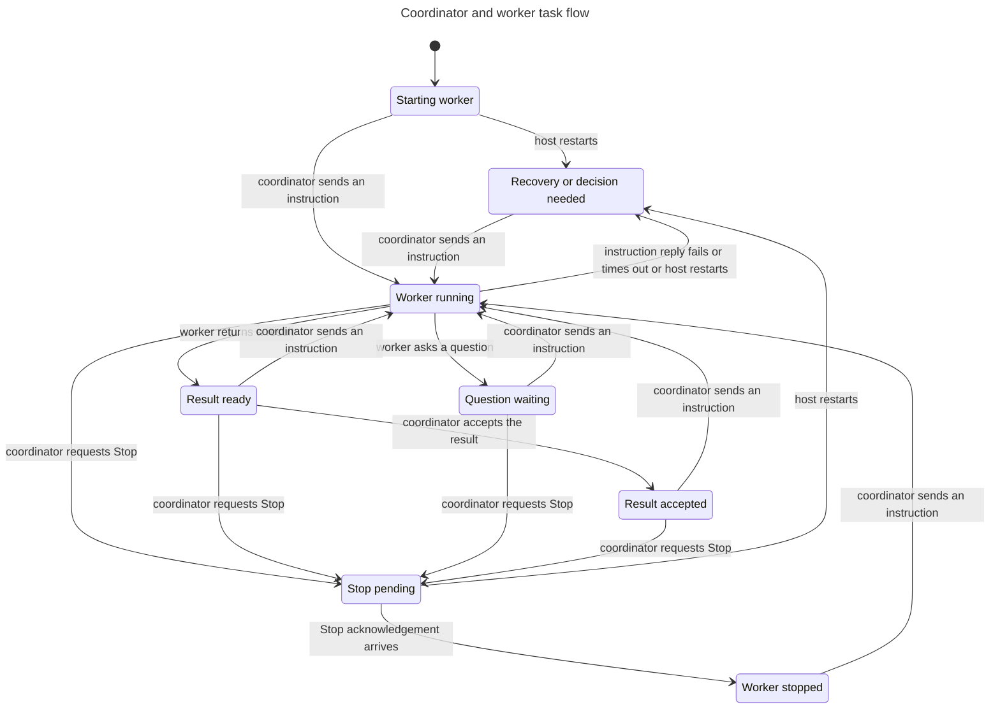
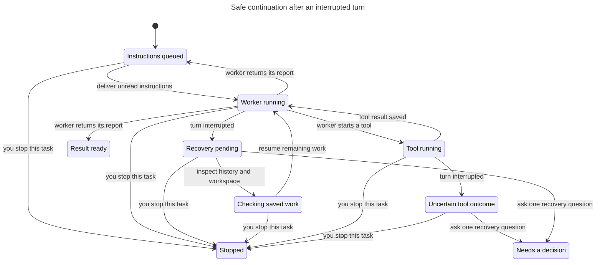

# Coordinator ordering and bounded recovery

Product source confirmed at `45f281d16ac145381304088a2e51208c0b219c6f`; see coverage.json. All seven safety properties and all nine real-host replays pass. All seven independent broken variants are caught by both TLC and code replay, and restored checks pass without modifying product files.

## Checked promises

| Model | Size | Properties |
| --- | --- | --- |
| WorkerFlow | 56 states / 242 steps | AcceptedResultStable, ReportsRequireWorking |
| RecoveryFlow | 223 states / 536 steps | NoDuplicateInputs, ReportsAreCurrent, StopWinsRecovery, UncertainEffectsBlock, RecoveryIsBounded |

WorkerFlow projects recovery/blocked states to one uncertainty state. RecoveryFlow separates queued inputs, read receipts, replaced generations, asynchronous inspection, Stop and tool outcomes. Neither is the runtime implementation.

The session-activity reconciliation adds only read-only list metadata in `SessionService.matches` and shared display activity helpers. No runtime status, command/report persistence, permissions, await boundaries or task transitions changed, so neither model needs a state/action change. The five combined session-list/worker-sheet/composer E2Es pass. Formal checks and negative controls are rechecked against the reviewed source; the UI itself remains outside these models.

The nine runtime traces cover delayed prompt acknowledgement/failure, Stop serialization and accepted results, reports during Stop, deduplicated recovery, stale generations, Stop during recovery, missing tool outcomes and a two-attempt budget. They use real host authorization, persistence, journal receipts and subprocess RPC. Only the Pi RPC endpoint is controlled. A follow-up cannot now overtake an unfinished Stop; the historical Stop/continuation race is prevented before dispatch.

## Negative controls

Each guard is disabled only in disposable source/model copies. The matching code replay fails, then the restored model/code passes.

| Property | Broken behavior | Shortest model path |
| --- | --- | --- |
| AcceptedResultStable | Older failed command can change accepted work | Accepted result overwritten by a delayed failure |
| ReportsRequireWorking | Non-working report can persist | A report after Stop |
| NoDuplicateInputs | Recorded bodies are sent again | Deliver → interrupt → inspect → resume with duplicate (4 steps) |
| ReportsAreCurrent | Generation is not checked | Deliver → interrupt → inspect → resume → read → old report accepted (6) |
| StopWinsRecovery | Stop cancellation/fencing is ignored | Deliver → interrupt → inspect → Stop → resume (5) |
| UncertainEffectsBlock | Missing tool result is ignored | Deliver → read → tool → interrupt → inspect → unsafe resume (6) |
| RecoveryIsBounded | Retry budget is ignored | Initial failure plus three recovery continuations (10) |

Negative-control development also caught two verifier issues: Stop's fixture must wait for the worker's read receipt before holding an active abort, and boolean ghost updates need explicit RHS parentheses in TLA+. These were checker/model errors, not product findings; no invariant was weakened.

At historical source `5720555`, delayed instruction failure and old Stop acknowledgement revoked accepted results. Command identity/active-state guards fixed those earlier defects. The current baseline preserves acceptance.

## Checked statecharts

The ordering view hides redundant Stop/failure arrows and unchanged-state acknowledgement/inspection steps; all remain checked. The recovery view hides only steps within one displayed state, including read bookkeeping and follow-ups that leave the current phase unchanged.

## Native integration evidence

The separate native-Pi proofs pass:

- `npm run test:coordinator`: existing/fresh/terminal-owned parents, coordinator-only input, investigation permissions, two coding worktrees, real edits/checks, reviewed conflict-safe integration and restart continuation.
- `npm run test:coordinator-recovery`: real saved shell result followed by provider failure, same-session/worktree continuation, unread follow-up across restart, rejected stale report/receipt, inconsistent input history, exhausted retries, Stop before and during Git inspection, capacity, mid-shell Pi kill and blocked replay, lost apply acknowledgement resolved without another apply, preserved parent draft/index.
- Composer/worker-sheet browser checks: 3 passed. Static checks and diff whitespace checks pass.

Only model responses/fault points are deterministic. Neither screenshots nor saved receipts establish paid-model planning quality or arbitrary shell exactly-once behavior.

## Run and limits

Run `npm run verify:coordinator`, or add `-- --self-test` for all seven negative controls. The printed evidence directory contains independent model verdicts and JSON replay traces. Use the formal skill and /statechart to read them.

Bounds: WorkerFlow has one owner/worker, one pending prompt/abort and one restart. RecoveryFlow has two input IDs, three interrupted turns, eight epochs and one Stop within one unfinished assignment episode. Atomic ledger writes and coherent complete transcript reads are assumed.

No multiple-worker/capacity proof, duplicate-request proof, filesystem/tool-policy proof, OS sandbox, orphan-shell reconciliation, arbitrary external exactly-once guarantee, main-turn recovery, notification liveness, code integration transaction, UI, power-loss durability or liveness proof. The native proofs cover selected integration/capacity/UI boundaries, not those general guarantees.
