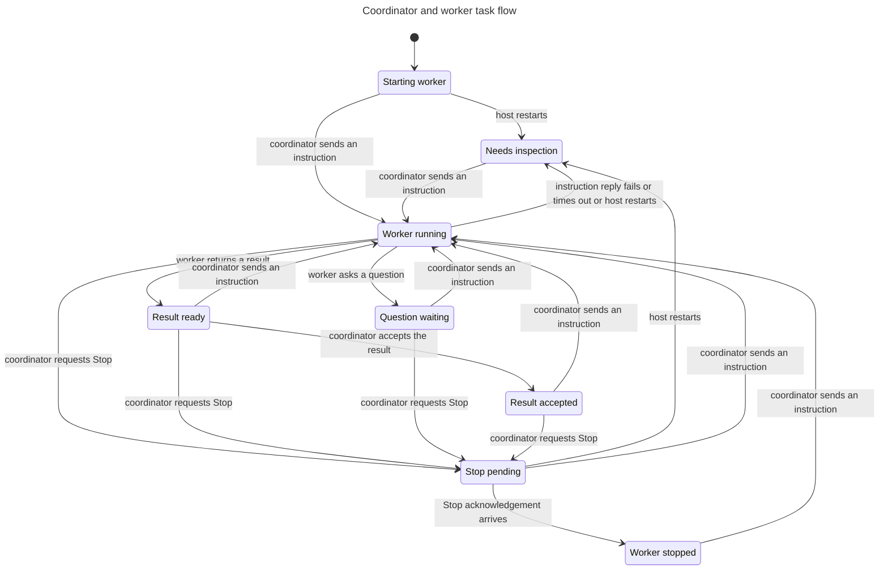

# Coordinator ordering

Source confirmed at `96f889e271d5750d9b7c50ad1e8021d19ee0e70f`. Both bounded properties hold. TLC reaches 80 states and 386 steps.

## Properties and regression replays

- `AcceptedResultStable`: acceptance remains valid until a new explicit instruction or Stop. Delayed instruction failures and old Stop acknowledgements must not revoke it.
- `ReportsRequireWorking`: a worker may persist a question or result only while its task is working.

The real-host `accepted-prompt-ack`, `accepted-prompt-failure`, and `accepted-stop-ack` replays end in `completed`. The `late-report` replay rejects a result during Stop and preserves `stopping` until the legitimate abort acknowledgement.

At historical source `5720555`, the failure and old Stop acknowledgement instead changed accepted results to `unknown` and `stopped`. Each command now captures a persisted command ID. A stale completion cannot update a newer command, failures cannot overwrite a question/report/acceptance, and the initial assignment catch handles startup failures only. Report text was retained even under the historical bugs; the lost acceptance state was the defect.

## Mutation sensitivity

The self-test separately removes the production report-state gate and the current/active-completion gate in disposable source copies, with matching model constants disabled. Each property must fail in both TLC and a real-host replay. Restoring the source returns each check to passing. This is not a mutation of the live host or user repositories.

## Checked statechart

The view omits acknowledgement/inspection stutters, redundant Stop requests, and failures unrelated to acceptance. All remain checked.

## Run and limits

Run `npm run verify:coordinator`, or add `-- --self-test` for both negative controls. The printed evidence directory contains model verdicts and one JSON trace per replay. Use `/skill:verify-coordinator-formal` and `/statechart` to interpret them.

Bounds: one coordinator, one investigation task, one pending prompt and one pending abort, one restart. The RPC endpoint is fault-controlled, not native Pi. Successful atomic ledger writes are assumed. There is no capacity, request-ID replay, filesystem permission, code integration, UI, power-loss durability, or liveness proof here. Report-to-turn freshness and multiple simultaneous prompts of the same kind are outside this model. Coding worktree/edit/check/integration behavior is exercised separately by the native-Pi coordinator E2E proof.
