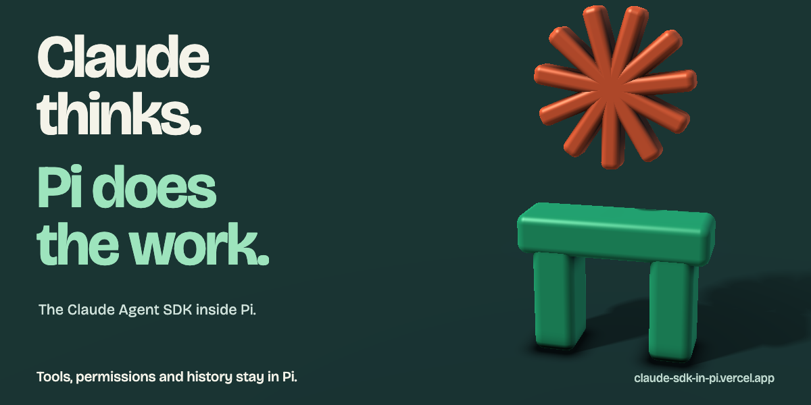
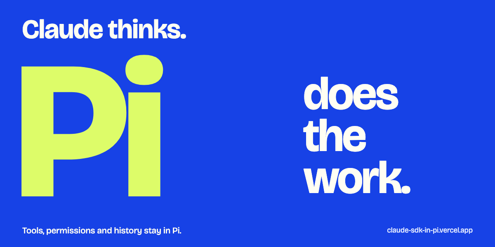
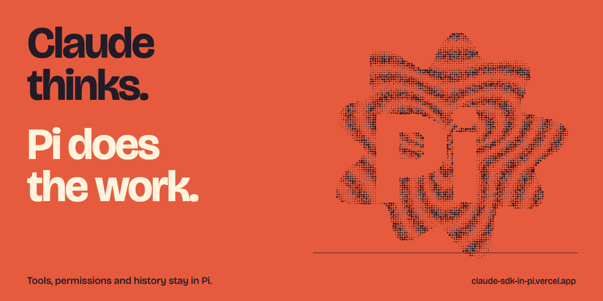

# Choose an article cover

Same article, three different visual ideas. Pick A, B or C, or point to the parts you want combined.

## A. Assembly

A 3D orange asterisk suspended above a green Pi sculpture. A dark, spatial cover.

## B. Overprint

Oversized Pi lettering, cobalt and lime. A typographic poster with no diagram.

## C. Signal print

A dense ink field opens into Pi letterforms. A warmer, screenprinted image.

---

These are cover prototypes, not implementation diagrams. The live share image is unchanged.
